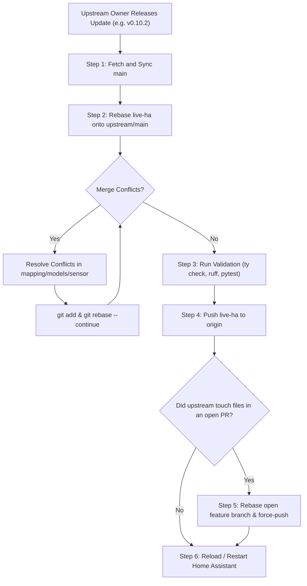

# Upstream Maintenance & Sync Guide: Managing Upstream Releases (Case 2 Workflow)

**Document:** `06_upstream_sync_and_maintenance_guide.md`  
**Target Repository:** `wirecuttr/ha-daikinone` (Fork of `zlangbert/ha-daikinone`)  
**Audience:** Future LLM Coding Agents & System Maintainers  
**Last Updated:** October 21, 2026  

---

## 1. Overview & Repository Architecture

This repository uses a two-tier branching strategy designed to isolate upstream pull requests while maintaining a single, unified codebase for daily production use in Home Assistant.

### The Branch Taxonomy

| Branch | Purpose | Base Branch | Upstream Destination |
|---|---|---|---|
| **`upstream/main`** | Official upstream release branch from `@zlangbert`. | None | Upstream core |
| **`main`** | Local mirror of `upstream/main` on `origin` (`wirecuttr`). | `upstream/main` | Fork default |
| **Feature Branches**<br>*(e.g., `feature/active-heat-source-sensor`, `add-dual-fuel-balance-point`, `fix-equipment-device-registry`)* | Isolated, single-responsibility branches for specific upstream PRs. | `upstream/main` | Upstream PRs (#136, #137, #138, etc.) |
| **`live-ha`** *(Integration Branch)* | Production branch running on the local Home Assistant instance. Combines all approved features and active PRs into one deployable build. | `upstream/main` | Local Home Assistant |

---

## 2. The Problem Statement: Case 2

### What is Case 2?
**Case 2 occurs when the upstream integration owner (`@zlangbert`) releases a new update (e.g. `v0.10.2` or `v0.11.0` merging PRs from other contributors or fixing bugs) while our custom PRs remain open in review.**

### The Objective
Pull all new upstream updates, bug fixes, and improvements into our running Home Assistant instance (`live-ha`) and keep our open PR branches clean, without creating messy merge commits, losing our custom features, or polluting upstream PR diffs.

---

## 3. Step-by-Step Procedure for Case 2



### Step 1: Fetch and Fast-Forward `main`
Always update your local `main` to match upstream first:

```bash
cd /workspace/ha-daikinone

# 1. Fetch latest commits and release tags from upstream
git fetch upstream --tags

# 2. Fast-forward local main to upstream/main
git checkout main
git merge --ff-only upstream/main

# 3. Keep fork's remote main in sync
git push origin main
```

---

### Step 2: Rebase the `live-ha` Integration Branch
Rebase `live-ha` on top of the newly updated `upstream/main`. This lifts your custom commits (OneClean, Schedule control, Dual-fuel balance point, Active heat source) and replays them on top of the new upstream baseline:

```bash
git checkout live-ha
git rebase upstream/main
```

#### Handling Rebase Conflicts (If Any Occur)
Conflicts typically occur in shared coordinator or registration files:
* `custom_components/daikinone/client/mapping.py`
* `custom_components/daikinone/client/models.py`
* `custom_components/daikinone/sensor.py`
* `custom_components/daikinone/const.py`

When Git pauses with a conflict:
1. Inspect the conflicted files:
   ```bash
   git status
   ```
2. Open each conflicted file and resolve the markers (`<<<<<<<`, `=======`, `>>>>>>>`). Keep both upstream's new logic and our integration's feature logic.
3. Mark resolved:
   ```bash
   git add <resolved-file>
   ```
4. Continue rebase:
   ```bash
   git rebase --continue
   ```
   *(Never run `git commit` during a rebase. If things go wrong, abort cleanly with `git rebase --abort`)*.

---

### Step 3: Run Full Local Verification
Before pushing to production, verify that the combined codebase passes all static checks and unit tests:

```bash
# 1. Run type checking
uv run ty check custom_components

# 2. Run linter and formatting check
uv run ruff check .
uv run ruff format --check custom_components

# 3. Run full test suite
uv run pytest
```

Ensure all tests pass and there are no lint or type warnings.

---

### Step 4: Push Updated `live-ha` to Remote
Because `live-ha` was rebased, push with `--force-with-lease` (safer than `--force` as it prevents overwriting unexpected remote work):

```bash
git push origin live-ha --force-with-lease
```

---

### Step 5: Update In-Flight Upstream PR Branches (If Applicable)
Check if the upstream release touched files that overlap with any open PR branches.
* If GitHub shows an open PR has a conflict with `main`:
  ```bash
  git checkout <feature-branch>   # e.g. feature/active-heat-source-sensor
  git rebase upstream/main
  # resolve any conflicts
  git push origin <feature-branch> --force-with-lease
  ```
* Pushing with `--force-with-lease` cleanly updates the existing GitHub Pull Request without creating duplicate commits or altering the PR discussion.

---

### Step 6: Deploy & Reload in Home Assistant
1. In Home Assistant, navigate to **Settings** > **Developer Tools** > **YAML** > **Restart** (or reload the Daikin One+ integration under **Devices & Services**).
2. Check Home Assistant logs for any deprecation warnings or setup errors:
   ```bash
   # Filter for daikinone in home-assistant.log
   grep -i "daikinone" /config/home-assistant.log
   ```

---

## 4. Summary of Case 1 (When Upstream Merges Our PRs)

When the upstream maintainer accepts and merges one or more of our PRs:

1. **Sync `main`:**
   ```bash
   git fetch upstream
   git checkout main
   git merge --ff-only upstream/main
   git push origin main
   ```
2. **Rebase `live-ha`:**
   ```bash
   git checkout live-ha
   git rebase upstream/main
   ```
   *Git will automatically drop our local commits that have already been merged upstream.*
3. **Retire the Merged Feature Branch:**
   ```bash
   git branch -d <merged-feature-branch>
   git push origin --delete <merged-feature-branch>
   ```

---

## 5. Golden Rules for Future Agents & Developers

1. **Never commit directly to `live-ha`:**  
   Always build new features or fixes on a dedicated branch branched from `upstream/main`. Once verified, merge or rebase the feature onto `live-ha`.
2. **Never branch a PR from `live-ha`:**  
   Upstream PR branches must branch cleanly from `upstream/main`. Stacking PRs on top of each other leads to messy review diffs and blocked merges.
3. **Always use `--force-with-lease`:**  
   When updating rebased branches on GitHub, never use bare `--force`.
4. **Preserve Sentinel Integrity:**  
   Ensure all Daikin equipment sentinels (`Sentinel.U8`, `Sentinel.U16`, `Sentinel.I16`) remain handled as `None` in `mapping.py` to avoid crashes on missing hardware sensors.
